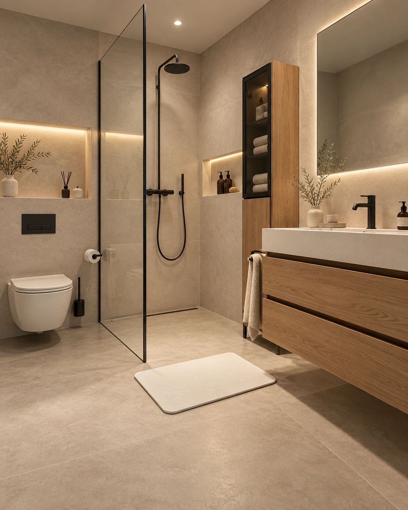

# Approved AVELNA bathroom environment — V1

**Visual approval:** Founder replied “Juisttt dat is de motion man” to the exact image shown in ChatGPT on 2026-10-31. This is an **approved environment / composition / visual-direction reference**, **not** a verified photograph of the final supplier product and **not yet an approved commercial product claim**.

- Asset path: `assets/approved/avelna-dutch-bathroom-approved-v1.webp`
- Dimensions: 1122 × 1402, vertical 4:5-ish
- Input: generated image adopted and re-uploaded by the founder; optimized WebP export (quality 90) for GitHub
- Approved for: motion-camera studies, art direction, page composition, lighting and look & feel
- Not approved for: inferring the actual Bath Stone SKU, thickness, color, exact texture, durability, stock or supplier certification
- Product-lock: pending exact SKU and product image reference
- Higgsfield Element creation: separate step, not automatically done by this GitHub commit

## Relationship to locked brand colors (2026-11-01)

The owner later locked **Palette 04 — Olive Mineral** for brand identity ([full specification](../../docs/brand-palette.md)); **Palette 03 — Sand & Linen** supplies photography/room-styling inspiration. Neither palette approval changes this exact approved environment image, its pixels, the approval scope, or the product-verification status. Do not claim this scene is already color-correct for a real supplier SKU. Logo assets, campaign masters and new scene renders require separate approvals.

## Creative direction captured

Realistic contemporary Dutch bathroom with large warm greige stone-look tiles and subtle grout, black trim and shower fittings, floating oak vanity, warm recessed light, glass walk-in shower, visually calm storage, minimal accessories and a prominent off-white rigid stone-looking bath mat outside the shower. Realistic scale and residential layout; not an exaggerated villa or hotel lobby.

**Next for ChatGPT:** write and approve the camera/motion prompt together with the founder. Hermes uses the exact prompt/approved reference without inventing replacement product shapes or style changes.

This asset is the first approved **environment concept**. Additional supplier-accurate product masters need a sample or rights-cleared factual product reference and their own explicit approval.
