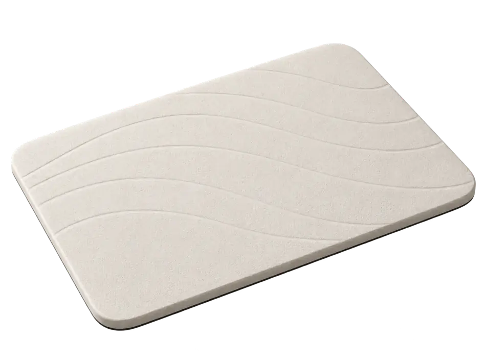
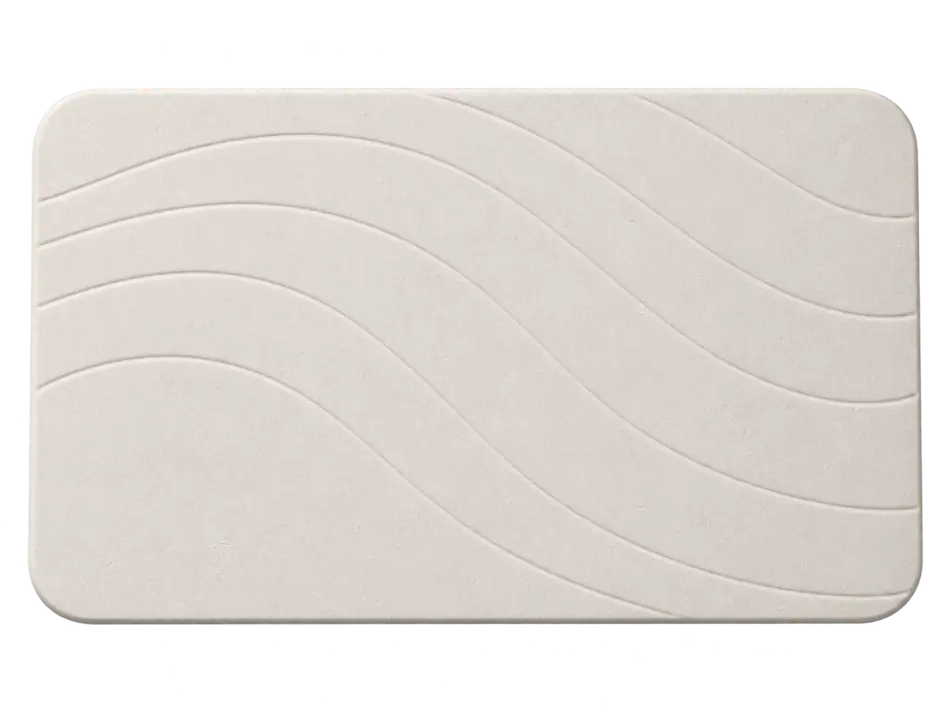
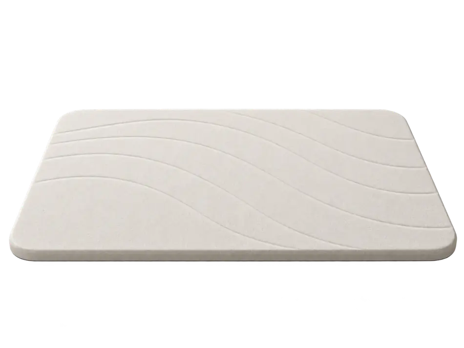

# Yongye VDSTM-007 — AI concept views (NOT verified product photos)

Supplier / product listing: https://www.alibaba.com/product-detail/Fast-Drying-Hard-Bath-Mat-Super_1601587124238.html

Seller: Longyan Yongye trade co., LTD. Product model stated on page: **VDSTM-007**. White diatomite hard mat, **39 × 60 cm**. Advertised product tier **US$4.60 for 1–99 sets**, but the same page also states MOQ 100 pcs. The supplier page does **not** establish that the image generation matches exact wave spacing, thickness, base material or color.

These are AI concept product visuals associated with that listing, **not supplier-authorized master photographs**. The shape and wave design are inspired by the vendor photography, but must not be used as conclusive evidence of the exact sold model or promoted into approved commercial/Elements identity without SKU match, rights clearance and sample review.

Files below are GitHub-optimized, RGBA transparent WEBP copies; originals were also uploaded to the connected Higgsfield media library, but no Higgsfield Element or video generation was performed.

| View | File | Higgsfield media UUID |
| --- | --- | --- |
| Three-quarter | [angle](./vdstm-007-wave-concept-angle-v1.webp) | ca1a84d6-e0e6-4b7b-8017-f5c2806e483e |
| Overhead | [top](./vdstm-007-wave-concept-top-v1.webp) | 7be2ff02-6834-4fa6-8327-c6871f3c7934 |
| Low frontal | [front](./vdstm-007-wave-concept-front-v1.webp) | bba10b27-289a-4944-b107-56f391cce095 |

Status: `concept_only`; `commercial_product_master_approved=false`; `exact_supplier_match_verified=false`. No paid generation credits used by GitHub writes.
